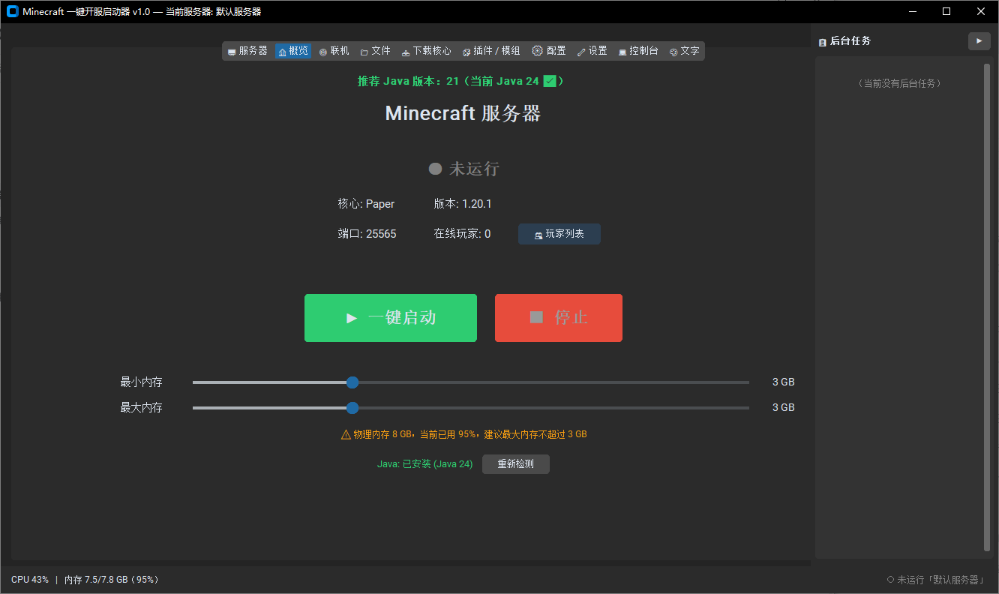
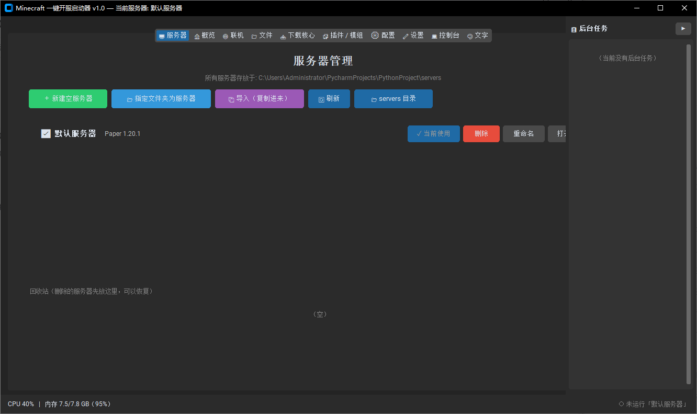
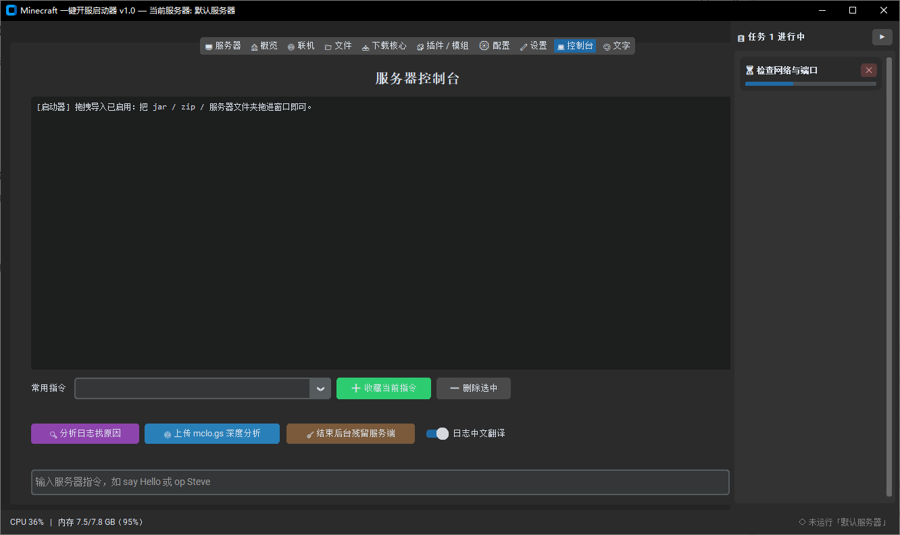
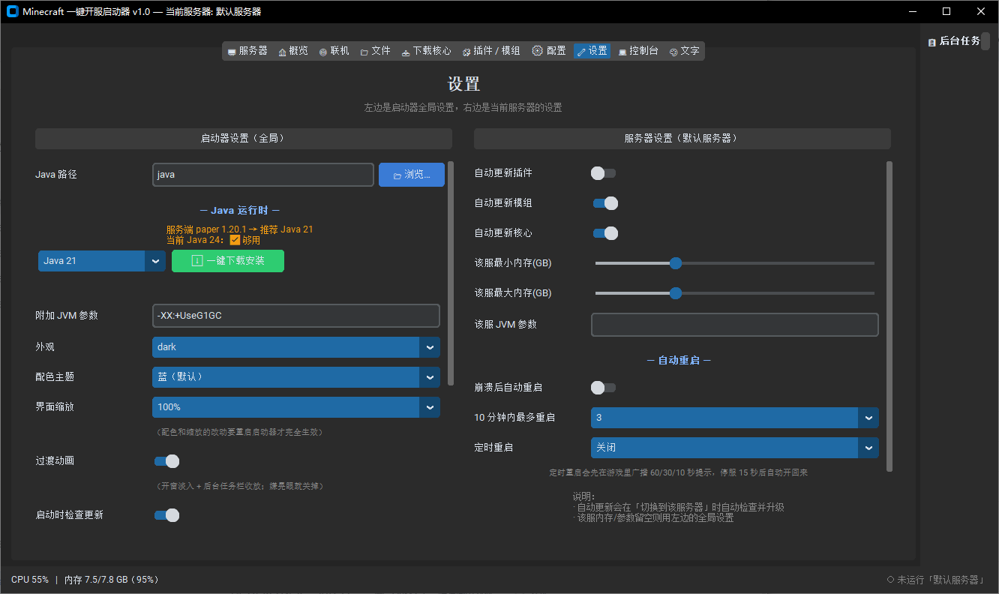

# Minecraft Simple Server Launcher

[English](README_EN.md) | [中文](README.md)

A Minecraft server launcher for people who would rather not touch a command line: create a server → download a server jar → start it → watch logs / install plugins / install Java, all from one window.

- Version: **1.0** (the whole 3.x series was a development line, called Development3.5 — see [CHANGELOG.md](CHANGELOG.md))
- Platform: Windows 10 / 11
- Shape: a single `minecraft-simple-server-launcher.py` file (~10k lines). No installer, no registry writes — delete the folder and it's gone
- UI: customtkinter; a collapsible task panel on the right shows background downloads with a ✕ cancel button

> The application UI itself is in Chinese. This English README exists so non-Chinese readers can understand what the project is.

## Screenshots

| Overview: one-click start | Servers: several servers side by side |
| --- | --- |
|  |  |
| **Console: logs + crash diagnosis + player commands** | **Settings: theme / scale / Java / auto-restart** |
|  |  |

## Features

| Tab | What it does |
| --- | --- |
| 🖥 Servers | Keep multiple servers side by side: create / import an existing server folder (used in place, files are never moved or rewritten) / rename / move to recycle bin / switch the active server |
| 🏠 Overview | Start & stop with one click; core version, memory, port, online player count |
| 🌐 Networking | Detect your LAN address, one-click open the Windows firewall port, copy the connect address |
| 📁 Files | Browse the server folder — jar, plugins, world |
| 📥 Download core | Vanilla / Paper / Purpur / Fabric straight from official sources; multi-connection download with resume and verification; **creates a new server by default and never overwrites an existing core**; also checks for core updates of an existing server (old core kept as `server.jar.bak`) |
| 🧩 Plugins / mods | Search Modrinth + Hangar, filter by game version / loader, install into `plugins/`, `mods/`, or `world/datapacks/` |
| ⚙ Config | Edit `server.properties` as a form (fields follow the server version), automatic backup before writing |
| 🔧 Settings | Theme / UI scale / Java path; one-click JRE install (Adoptium + Tsinghua mirror, sha256 verified, verified by actually running `java -version`) |
| 💻 Console | Colored logs, automatic diagnosis of common crashes (gives a conclusion, not riddles), join/leave messages, offline player inventory viewer (reads `world/playerdata`) |
| 🎨 Text | Minecraft color codes (`&a` style) editor with live preview, for MOTDs and sign text |

## Run from source

Requires Python 3.10+ (developed on 3.14).

```bat
pip install -r requirements.txt
python minecraft-simple-server-launcher.py
```

On first run it creates these next to the script:

```
servers/                one folder per server (world, plugins, jar)
launcher_settings.json  launcher settings (includes the local Java path)
.trash/                 deleted servers are moved here first, recoverable
```

> These are **runtime data — do not commit them** (`.gitignore` already excludes them).
> You can also import an existing server folder from the Servers tab; the launcher uses it in place and never rewrites your files.

## Build a standalone exe

```bat
pip install pyinstaller
pyinstaller wow.spec
```

The result is `dist/minecraft-simple-server-launcher.exe` (single file, console attached). First start is a few seconds slower than running from source (unpacking) and uses more memory.

## Network access

Everything below is unauthenticated:

- GitHub API / Paper API / Purpur API / Fabric Meta / Mojang — version lookup, server jars
- Modrinth API, Hangar API — plugin search
- `mirrors.tuna.tsinghua.edu.cn` / `api.adoptium.net` — JRE installation

Official sources can be slow from mainland China; the Java installer already defaults to the Tsinghua mirror, and core downloads use multi-connection acceleration with resume.

## Known limitations

- Windows only (relies on `netsh`, `taskkill`, process image path queries, etc.)
- Single file, no automated test directory; the author is still learning, and the code prioritizes "it works" over style
- No self-update yet — upgrading means replacing `minecraft-simple-server-launcher.py` / `.exe`

## Why a single file (~10k lines)

A deliberate trade-off, not laziness:

- **For users**: copy one `.py` file and it runs; no project structure to understand, and packaging to an exe needs a single entry point
- **For the author**: one file means no jumping between a dozen modules while still learning
- **The cost**: a long file with inconsistent naming across periods. If you build on it, jump by feature — every section is marked with `# ==================== xxx ====================` — instead of reading top to bottom
- **No bundled automated tests**: verification scripts written during development were temporary and are not in the repo; the repo only ships what runs

## License

MIT, see [LICENSE](LICENSE). Minecraft is a trademark of Mojang Studios; this project is not affiliated with Mojang.
